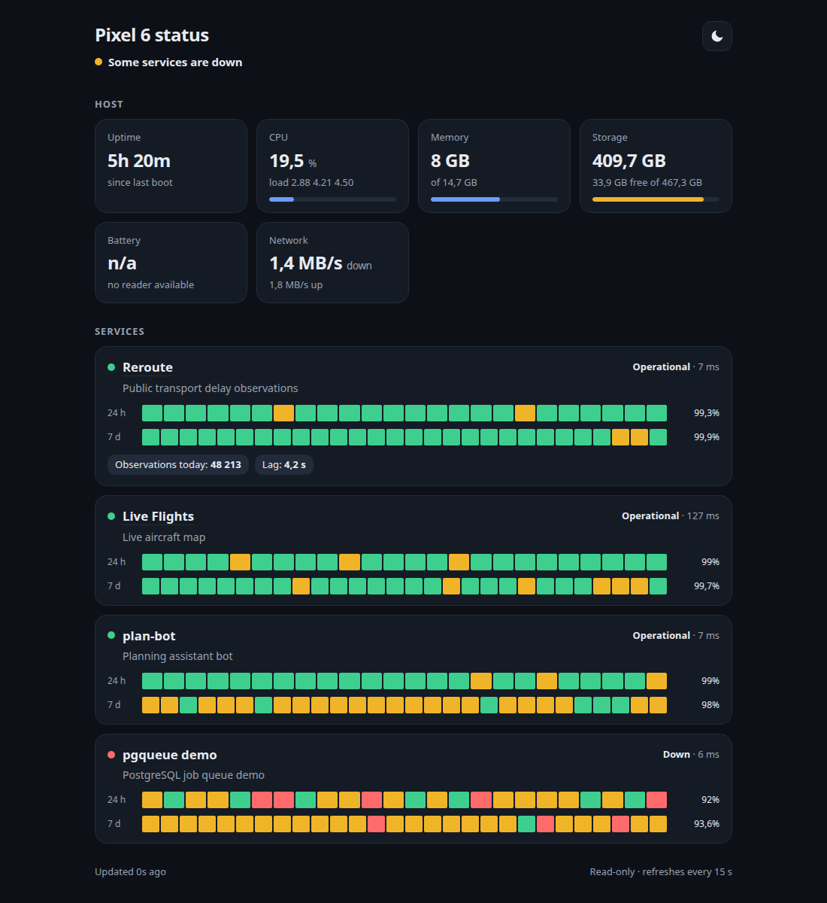
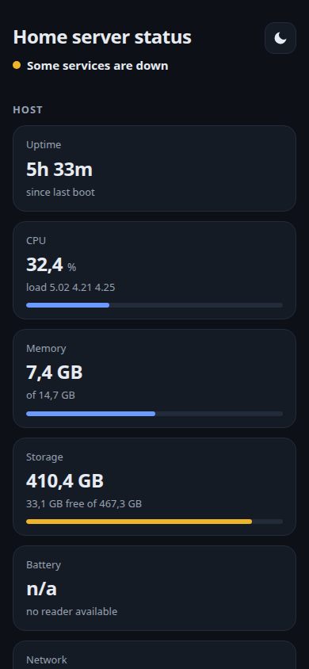
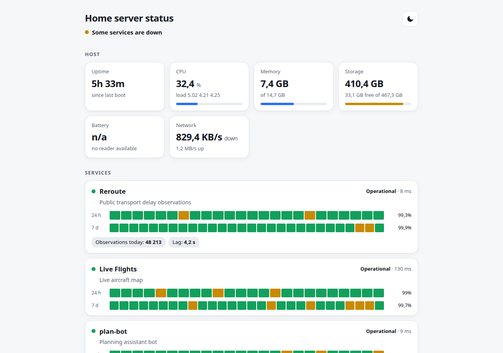

# server-status

[](https://github.com/MaciejZiel/server-status/actions/workflows/ci.yml)

A small, read-only status page for a self-hosted home server that hosts several demo apps.
One page, mobile-first, dark and light, no external assets.



<p>
  
  
</p>

The screenshots were taken with `playwright-cli` against a local run with fake services (`tools/run_demo.sh`).

## What it shows

- **Host**: uptime, CPU, memory, storage, battery (level, charging state, temperature) and network throughput.
  Every reader degrades on its own: if the system does not expose a value, that card shows `n/a` and the rest keeps working.
- **Services**: a configurable list with up/down state, latency and 24 h / 7 d uptime bars.
  Uptime is computed from the checker's own results stored in SQLite (24 hourly buckets, 28 six-hour buckets).
- **Metrics**: optional per-service JSON document; configure a URL and the fields to display.

Design constraints: no secrets or internal URLs in the page or API, read-only (GET/HEAD only), cached responses, strict CSP,
no CDN scripts or fonts, standard library only (no runtime dependencies, Python 3.12-3.14).

## Quick start

```sh
cp services.example.toml services.toml     # edit your services
PYTHONPATH=src python3 -m server_status      # http://127.0.0.1:8090/
```

Try it with fake services and seeded history:

```sh
tools/run_demo.sh                           # http://127.0.0.1:8190/
```

## Configuration

Environment variables (all optional):

| Variable | Default | Meaning |
| --- | --- | --- |
| `SERVER_STATUS_HOST` | `127.0.0.1` | Listen address |
| `SERVER_STATUS_PORT` | `8090` | Listen port |
| `SERVER_STATUS_BASE_PATH` | empty | URL prefix when served below a path, e.g. `/status` |
| `SERVER_STATUS_TITLE` | `Home server status` | Page title |
| `SERVER_STATUS_SERVICES_FILE` | `services.toml` | Service list |
| `SERVER_STATUS_DB_PATH` | `data/status.sqlite` | SQLite file for check history |
| `SERVER_STATUS_CHECK_INTERVAL` | `45` | Seconds between service checks (min 5) |
| `SERVER_STATUS_HOST_INTERVAL` | `15` | Seconds between host samples (min 2) |
| `SERVER_STATUS_RETENTION_DAYS` | `8` | Days of history kept (min 8) |
| `SERVER_STATUS_STORAGE_PATH` | `~` | Path whose filesystem is shown as storage |
| `SERVER_STATUS_LOG` | `INFO` | Log level |

The old `PHONE_STATUS_*` names (from before the rename to server-status) are still read for one release and log a deprecation warning; `SERVER_STATUS_*` wins when both are set.

Services live in a TOML file (see `services.example.toml`):

```toml
[[services]]
id = "reroute"
name = "Reroute"
description = "Public transport delay observations"
health_url = "http://127.0.0.1:8081/health"   # 2xx/3xx = up; never sent to the browser
link = "https://example.com/reroute/"           # optional public link
metrics_url = "http://127.0.0.1:8081/api/stats" # optional

[[services.metrics]]
path = "observations.today"                     # dotted path, list indexes allowed
label = "Observations today"
unit = ""
```

Only numbers, booleans and short strings at the configured paths are shown.

## HTTP interface

| Path | Description |
| --- | --- |
| `/` | The page |
| `/api/status` | JSON document used by the page (`Cache-Control: public, max-age=5`) |
| `/healthz` | Liveness probe |
| `/static/*` | Own CSS, JS and icon |

Host sampling and service checks run in background threads; requests only read the latest snapshot and a short-lived serialised copy,
so the page cannot be used to make the server do work.

## Self-hosting on Termux

Files are in `deploy/termux/`.

```sh
pkg install python git                      # termux-api is optional (battery)
git clone https://github.com/MaciejZiel/server-status ~/server-status && cd ~/server-status
cp services.example.toml services.toml     # edit
cp deploy/termux/env.example deploy/termux/env
sh deploy/termux/start.sh                   # runs python -m server_status in the foreground
```

- `deploy/termux/start.sh` loads `deploy/termux/env`, sets `PYTHONPATH` and starts the service (it also takes a wake lock when available).
- `deploy/termux/env.example` lists all settings. The service binds to `127.0.0.1` only.
- `deploy/termux/nginx-server-status.conf` is a location snippet that proxies `/status/` to the service and only allows GET/HEAD.
  Use `SERVER_STATUS_BASE_PATH=/status` with it (the app also works when a proxy strips the prefix).
- Autostart with Termux:Boot: copy `deploy/termux/boot-server-status` to `~/.termux/boot/server-status` and `chmod +x` it.
- For the battery card install the Termux:API app and `pkg install termux-api`. Without it the sysfs fallback is tried, otherwise the card shows `n/a`.
  Battery reads are cached for a minute and back off for ten minutes when nothing answers.

What the host readers can read on Android 16 (checked in Termux, without root):

| Value | Source used | Works |
| --- | --- | --- |
| Uptime | `/proc/uptime` denied, falls back to `CLOCK_BOOTTIME` | yes |
| CPU | `/proc/stat` denied, falls back to cpuidle residency in `/sys/devices/system/cpu/cpu*/cpuidle` | yes |
| Load average | `getloadavg()` (bionic uses `sysinfo()`; `/proc/loadavg` itself is denied) | yes |
| Memory | `/proc/meminfo` | yes |
| Storage | `statvfs` on `~`, `/data` and `/sdcard` (same volume) | yes |
| Battery | `/sys/class/power_supply` denied; needs Termux:API + `termux-api` | only with Termux:API |
| Network | `/proc/net/dev`, `/sys/class/net` and netlink `RTM_GETLINK` are all denied | no, card shows `n/a` |

Hardening: the service binds to `127.0.0.1` and should only be reached through nginx. It closes connections that stay idle
for 10 s and accepts at most 64 at a time; nginx in front absorbs slow clients, limits methods and body size, and can
rate-limit (see the commented `limit_req` lines in the snippet). The SQLite history is pruned hourly to the retention window,
so the file stays at a few MB.

Expected footprint (measured on a desktop, 4 services, 45 s interval): about 40 MB RSS, roughly 14 KB for the page and assets,
4 KB for the JSON, about 1.5 ms per API request, and a few MB of SQLite for 8 days of history.

## Development

```sh
python3 -m venv .venv && .venv/bin/pip install -r requirements-dev.txt
.venv/bin/ruff check . && .venv/bin/ruff format --check .
.venv/bin/pytest
. .venv/bin/activate && npx --yes pyright@1.1.414   # type check (needs Node)
```

Host readers are injectable (`HostReaders`), so tests never touch the real machine; the HTTP layer and the checker are tested
against local servers on random ports. CI runs the same commands on Python 3.12, 3.13 and 3.14, plus pyright in a separate job.

Third-party components (development tools only) are listed in `3rdparty_licenses.md`.

## License

MIT, see `LICENSE`.
