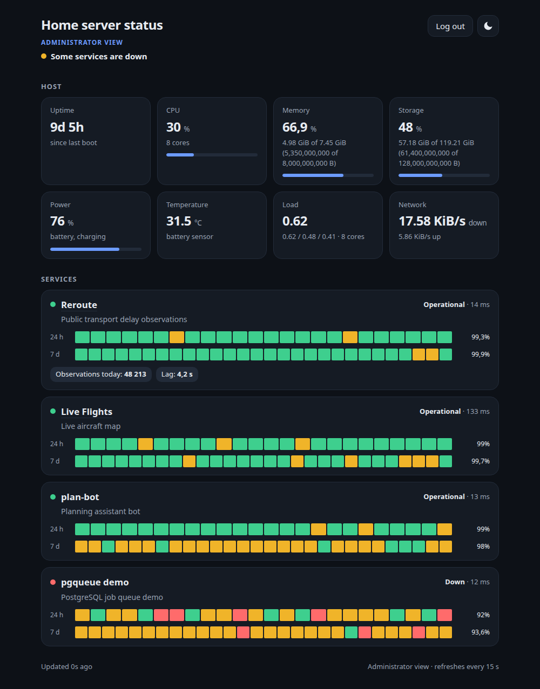

<p align="center">
  
</p>

<h1 align="center">server-status</h1>

<p align="center">
  <b>A small, read-only status page for a self-hosted home server that hosts several demo apps.</b>
</p>

<p align="center">
  <a href="https://status.maciejzielinski.dev">Live status</a> · <a href="https://maciejzielinski.dev">Portfolio</a>
</p>

<p align="center">
  <a href="https://github.com/MaciejZiel/server-status/actions/workflows/ci.yml"></a>
  <a href="LICENSE"></a>
  
</p>

<p align="center">One page, mobile-first, dark and light, no external assets.</p>

<p align="center">
  <picture>
    <source media="(prefers-color-scheme: dark)" srcset="docs/screenshots/desktop-dark.png">
    
  </picture>
</p>

<p align="center">
  
</p>

<p align="center">
  
</p>

<p align="center"><sub>Taken with <code>playwright-cli</code> against a local run with fake services (<code>tools/run_demo.sh</code>, invented host figures). The last image is the administrator view. Desktop: dark or light, following your GitHub theme.</sub></p>

## What it shows

- **Host**: uptime (to the hour) and CPU, memory and storage usage rounded to 5 %.
  Every reader degrades on its own: if the system does not expose a value, that card shows `n/a` and the rest keeps working.
- **Services**: a configurable list with up/down state, latency and 24 h / 7 d uptime bars.
  Uptime is computed from the checker's own results stored in SQLite (24 hourly buckets, 28 six-hour buckets).
- **Metrics**: optional per-service JSON document; configure a URL and the fields to display.

What the public JSON deliberately leaves out: exact byte counts, core count, load averages, network rates, power and temperature,
and anything about a failed check except a generic reason (`timeout`, `connection refused`, `HTTP 502`, ...; never a URL, host, port or path).
The sampler still collects more than it serves; `status.public_host()` is the single place that decides what leaves the process.

The public page does draw four more host cards (Power, Temperature, Load, Network) so it looks the same as the administrator view,
but their values are fixed made-up placeholders, rendered blurred, with a note that the details are visible to the administrator.
The real figures are never sent to a public visitor, so removing the blur in the browser reveals nothing.

## Administrator view

For the owner: every figure the sampler collects, behind a login. It is off unless `SERVER_STATUS_ADMIN_TOKEN` is set to a secret of at least 24 characters;
without it `/admin` and `/api/admin/*` answer 404.

- `/admin/login`: a form (POST over HTTPS) for the token. The token is compared with `hmac.compare_digest`, never logged and never sent back.
- On success the app sets a random session id in a cookie (`__Secure-ss_admin`: `HttpOnly`, `Secure`, `SameSite=Strict`, scoped to the base path, 12 hours).
  Sessions live in memory (at most 64), so a restart logs everybody out.
- Login attempts are limited to 5 per 5 minutes per visitor (`CF-Connecting-IP`, else the socket address); then 429 with `Retry-After`.
  nginx adds an outer limit (see the deploy notes below).
- `/admin` shows the full page: exact uptime and CPU, memory and storage in bytes, cores, load averages, power (charge, state, temperature) and network rates,
  per-service latency and the full text of a failed check. `/api/admin/status` is the same data as JSON. Both send `Cache-Control: no-store`.
- Without a valid cookie `/admin` redirects to the login and `/api/admin/status` answers 401. `POST /admin/logout` ends the session.

Generate the token on the server and keep it out of the repository and the chat:

```sh
umask 077
python3 -c 'import secrets;print(secrets.token_urlsafe(32))' > ~/.server-status-admin-token
chmod 600 ~/.server-status-admin-token
```

Reference it from `deploy/termux/env` (which `start.sh` sources): `SERVER_STATUS_ADMIN_TOKEN="$(cat "$HOME/.server-status-admin-token")"`.
To log in, read the token yourself on the server (`cat ~/.server-status-admin-token`) and paste it into the form.
To rotate it, write a new file and restart the service.

Design constraints: no secrets or internal URLs in the page or API, read-only for the public (GET/HEAD only; the only POSTs are the administrator login and logout), cached responses, strict CSP,
no CDN scripts or fonts, standard library only (no runtime dependencies, Python 3.12-3.14).

## Quick start

```sh
cp services.example.toml services.toml     # edit your services
PYTHONPATH=src python3 -m server_status      # http://127.0.0.1:8090/
```

Try it with fake services and seeded history:

```sh
tools/run_demo.sh                           # http://127.0.0.1:8190/
```

## Configuration

Environment variables (all optional):

| Variable | Default | Meaning |
| --- | --- | --- |
| `SERVER_STATUS_HOST` | `127.0.0.1` | Listen address |
| `SERVER_STATUS_PORT` | `8090` | Listen port |
| `SERVER_STATUS_BASE_PATH` | empty | URL prefix when served below a path, e.g. `/status` |
| `SERVER_STATUS_TITLE` | `Home server status` | Page title |
| `SERVER_STATUS_SERVICES_FILE` | `services.toml` | Service list |
| `SERVER_STATUS_DB_PATH` | `data/status.sqlite` | SQLite file for check history |
| `SERVER_STATUS_CHECK_INTERVAL` | `45` | Seconds between service checks (min 5) |
| `SERVER_STATUS_HOST_INTERVAL` | `15` | Seconds between host samples (min 2) |
| `SERVER_STATUS_RETENTION_DAYS` | `8` | Days of history kept (min 8) |
| `SERVER_STATUS_STORAGE_PATH` | `~` | Path whose filesystem is shown as storage |
| `SERVER_STATUS_ADMIN_TOKEN` | unset | Secret for the administrator view (min 24 characters); unset = view disabled |
| `SERVER_STATUS_LOG` | `INFO` | Log level |

Environment names from before the rename to server-status (the old prefix is named in the deprecation warning) are still read for one release; `SERVER_STATUS_*` wins when both are set.

Services live in a TOML file (see `services.example.toml`):

```toml
[[services]]
id = "reroute"
name = "Reroute"
description = "Public transport delay observations"
health_url = "http://127.0.0.1:8081/health"   # 2xx/3xx = up; never sent to the browser
link = "https://example.com/reroute/"           # optional public link
metrics_url = "http://127.0.0.1:8081/api/stats" # optional

[[services.metrics]]
path = "observations.today"                     # dotted path, list indexes allowed
label = "Observations today"
unit = ""
```

Only numbers, booleans and short strings at the configured paths are shown.

## HTTP interface

| Path | Description |
| --- | --- |
| `/` | The page |
| `/api/status` | JSON document used by the page (`Cache-Control: public, max-age=5`) |
| `/healthz` | Liveness probe |
| `/admin`, `/admin/login`, `/admin/logout` | Administrator page, login form, logout (POST); 404 when no token is set |
| `/api/admin/status` | Full host data as JSON, session cookie required (`Cache-Control: no-store`) |
| `/static/*` | Own CSS, JS and icons |
| `/favicon.ico`, `/apple-touch-icon.png` | Icons for the automatic browser requests (cached for a day) |

Host sampling and service checks run in background threads; requests only read the latest snapshot and a short-lived serialised copy,
so the page cannot be used to make the server do work.

## Self-hosting on Termux

Files are in `deploy/termux/`.

```sh
pkg install python git
git clone https://github.com/MaciejZiel/server-status ~/server-status && cd ~/server-status
cp services.example.toml services.toml     # edit
cp deploy/termux/env.example deploy/termux/env
sh deploy/termux/start.sh                   # runs python -m server_status in the foreground
```

- `deploy/termux/start.sh` loads `deploy/termux/env`, sets `PYTHONPATH` and starts the service (it also takes a wake lock when available).
- `deploy/termux/env.example` lists all settings. The service binds to `127.0.0.1` only.
- nginx, three files:
  - `nginx-server-status.conf`: location snippet that proxies `/status/` to the service, only allows GET/HEAD and rate-limits
    (10 requests/s per visitor, burst 40, then 429). Use `SERVER_STATUS_BASE_PATH=/status` with it (the app also works when a proxy strips the prefix).
  - `nginx-zones.conf`: goes in the `http { }` block. Behind a Cloudflare Tunnel every request arrives from `127.0.0.1`, so the limit is keyed on
    `CF-Connecting-IP` (falling back to the remote address). nginx must be reachable only through the tunnel, or that header can be forged.
  - `nginx-headers.conf`: copy to `snippets/server-status-headers.conf`. CSP, `nosniff`, `frame-ancestors 'none'`, `Referrer-Policy`, also on nginx's own 301/429/502 responses.
  - `nginx-server-status-admin.conf`, `nginx-headers-admin.conf` (copy to `snippets/server-status-headers-admin.conf`): locations for `/status/admin` and `/status/api/admin`.
    No caching, GET/HEAD/POST only, 5 login requests per minute per visitor (zone `statuslogin` from `nginx-zones.conf`), the same security headers except
    `form-action 'self'` so the login form can post.
- Autostart with Termux:Boot: copy `deploy/termux/boot-server-status` to `~/.termux/boot/server-status` and `chmod +x` it.

What the host readers can read on Android 16 (checked in Termux, without root):

| Value | Source used | Works |
| --- | --- | --- |
| Uptime | `/proc/uptime` denied, falls back to `CLOCK_BOOTTIME` | yes |
| CPU | `/proc/stat` denied, falls back to cpuidle residency in `/sys/devices/system/cpu/cpu*/cpuidle` | yes |
| Load average | `getloadavg()` (bionic uses `sysinfo()`; `/proc/loadavg` itself is denied) | yes |
| Memory | `/proc/meminfo` | yes |
| Storage | `statvfs` on `~`, `/data` and `/sdcard` (same volume) | yes |
| Network | `/proc/net/dev`, `/sys/class/net` and netlink `RTM_GETLINK` are all denied | no (collected, not published) |

Hardening: the service binds to `127.0.0.1` and should only be reached through nginx. It closes connections that stay idle
for 10 s and accepts at most 64 at a time; nginx in front absorbs slow clients, limits methods and body size, and rate-limits per visitor (see the snippets above).
The SQLite history is pruned hourly to the retention window,
so the file stays at a few MB.

Expected footprint (measured on a desktop, 4 services, 45 s interval): about 40 MB RSS, roughly 14 KB for the page and assets,
4 KB for the JSON, about 1.5 ms per API request, and a few MB of SQLite for 8 days of history.

## Tech stack

| Layer | Used |
|---|---|
| Runtime | Python 3.12 to 3.14, standard library only |
| Storage | SQLite (check history) |
| Page | Own CSS, JS and icons, no CDN scripts or fonts |
| Quality | pytest, ruff, pyright, GitHub Actions |

## Development

```sh
python3 -m venv .venv && .venv/bin/pip install -r requirements-dev.txt
.venv/bin/ruff check . && .venv/bin/ruff format --check .
.venv/bin/pytest
. .venv/bin/activate && npx --yes pyright@1.1.414   # type check (needs Node)
```

Host readers are injectable (`HostReaders`), so tests never touch the real machine; the HTTP layer and the checker are tested
against local servers on random ports. CI runs the same commands on Python 3.12, 3.13 and 3.14, plus pyright in a separate job.

Third-party components (development tools only) are listed in `3rdparty_licenses.md`.

## Licence

MIT, see `LICENSE`.
